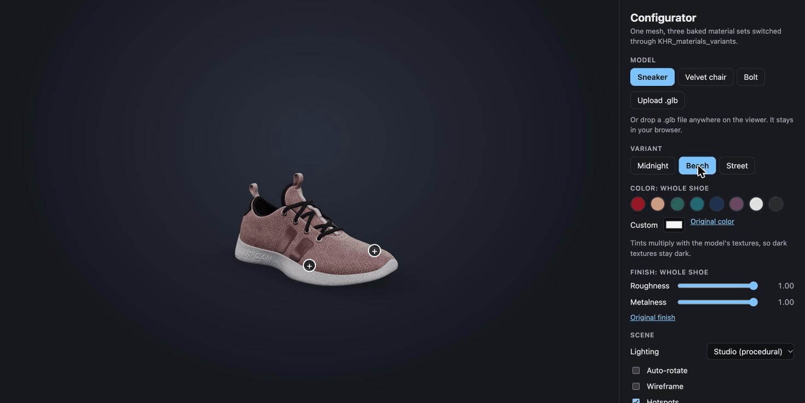

# 3D Product Configurator

> **This is a learning project.** I'm using it to get hands-on with React Three Fiber, so expect rough edges and experiments rather than production-ready code.

A browser-based product configurator built with React Three Fiber. Orbit, click, recolor, and take apart two glTF models in real time.

[Live demo](https://philorien.github.io/r3f-configurator/)



## What it does

- **Configure**: switch between baked material variants, click or pick a part, then change its color, roughness and metalness, hide it, or explode the model apart.
- **Upload your own**: drop a `.glb` on the viewer (or use the Upload button). Parts and variants are discovered from the file, and the file never leaves your browser. Limit 50 MB.
- **Share a configuration**: the address bar always holds a link to the current model, variant, part, colors, finishes, explode distance and lighting. "Copy link" copies it. Links are validated on load, so a hand-edited URL can only produce a valid configuration.
- **Export**: transparent-background PNG captured from the live canvas.

## How it's built

- **glTF pipeline**: bundled models were optimized with `gltf-transform` (meshopt compression, WebP textures at 1024px). 4.1 MB and 7.8 MB source files ship at 743 KB and 546 KB.
- **KHR_materials_variants**: three.js's `GLTFLoader` doesn't implement this extension, so variant mappings are read from the parsed glTF JSON and resolved to materials per mesh (`src/components/Model.tsx`).
- **Code splitting**: the page shell is 238 KB (75 KB gzipped). The viewer (339 KB) and three.js (737 KB) load lazily as separate chunks.
- **Hotspots** are plain DOM buttons positioned each frame from projected 3D anchors, rather than drei's `<Html>`, which clashed with React 19 when models were swapped.
- **State**: one Zustand store; the URL is derived from it (`src/share.ts`, `src/urlSync.ts`).
- **Performance**: adaptive DPR via `PerformanceMonitor`, private material clones so cached GLTFs are never mutated.

## Accessibility

- Every control is a native, labelled form element; groups use `fieldset` and `legend`.
- The viewer is focusable. Arrow keys orbit, `+` and `-` zoom, `Home` resets. (OrbitControls only maps arrow keys to panning, so this is custom code.)
- Skip link, and a polite live region that announces variant, part, upload and copy-link changes.
- Honors `prefers-reduced-motion` (no auto-rotate, easing, or selection pulse) and `forced-colors`.
- Auto-rotate pauses while a hotspot is hovered or focused, and can be switched off.
- Reflows at 320px wide.
- Automated: axe-core (WCAG 2.2 AA tags) runs in the end-to-end suite against the default view, the chair, and an uploaded model. Automated checks can't judge everything, and I haven't tested with a screen reader.

## Tests

```bash
npm test          # Vitest: share encoding, part grouping, upload validation, store, panel (jsdom)
npm run test:e2e  # Playwright + axe in real Chrome: keyboard orbit, links, uploads, drag and drop, a11y
```

The end-to-end tests use your installed Google Chrome with software WebGL, so no browser download is needed. CI runs lint, build, both suites, then deploys to GitHub Pages only if they pass.

## Stack

Vite, React 19, TypeScript, three.js, `@react-three/fiber`, `@react-three/drei`, Zustand, Vitest, Testing Library, Playwright, axe-core.

## Run it

```bash
npm install
npm run dev   # http://localhost:5173/r3f-configurator/
```

## Known limits

- Color tints multiply with baked textures, so dark textures stay dark. A real product pipeline would expose a dedicated tint mask.
- The sneaker is a single mesh, so it has no separate parts to hide or explode, and its roughness/metalness sliders read 1.00 because the file drives them with texture maps.
- Hotspots are hand-placed as fractions of the bounding box, and aren't occluded when they face away from the camera.
- Uploaded models can't be shared by link. Draco-compressed uploads fetch their decoder from Google's CDN.
- Only `.glb` is supported; a `.gltf` with external textures can't be loaded from a single drop.

## Credits

Models are from the [Khronos glTF Sample Assets](https://github.com/KhronosGroup/glTF-Sample-Assets) (MaterialsVariantsShoe and SheenChair), licensed CC-BY 4.0. Check each model's license file before redistributing.
